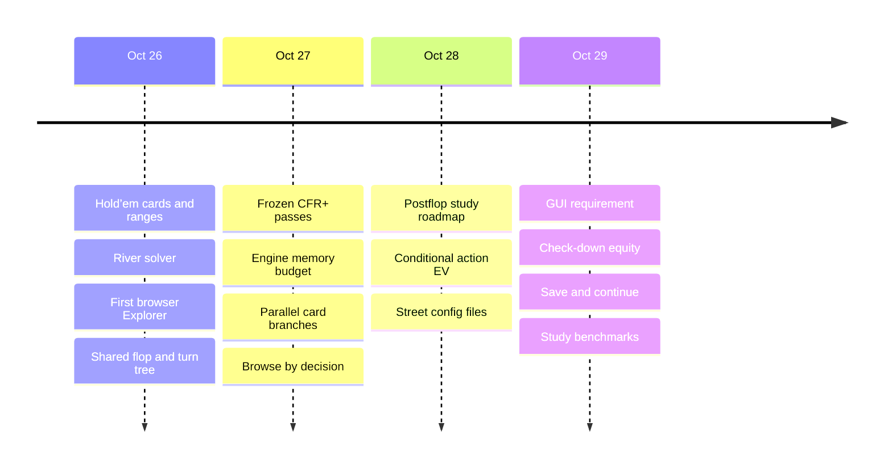
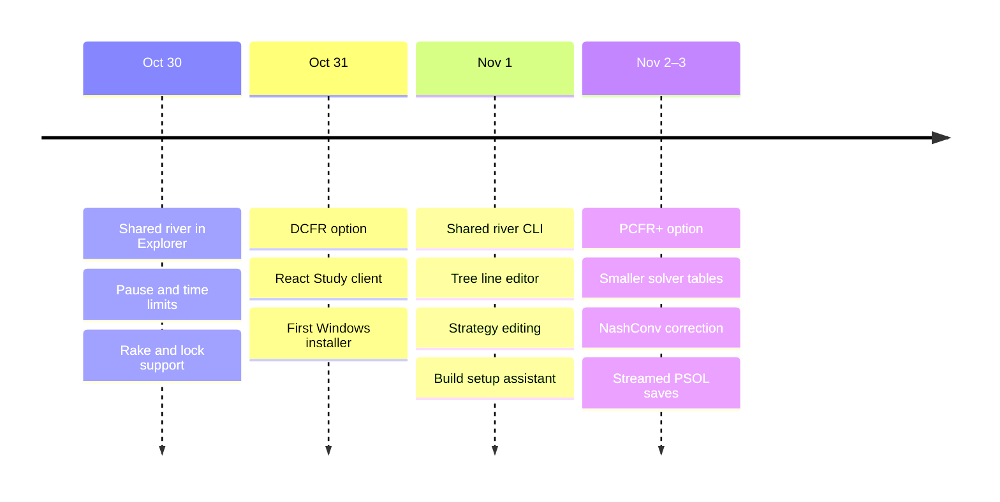
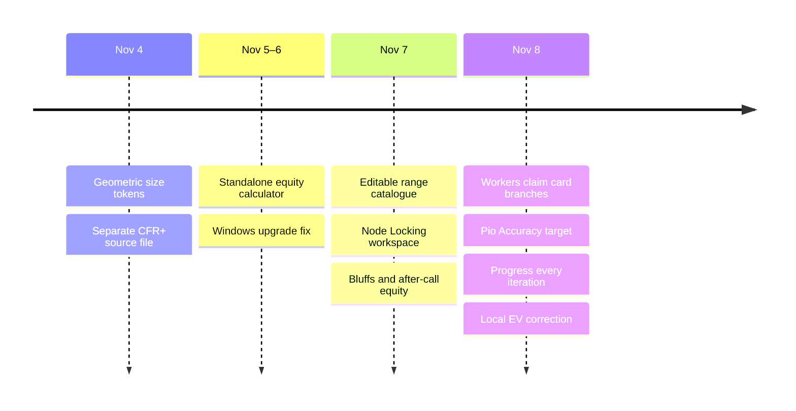
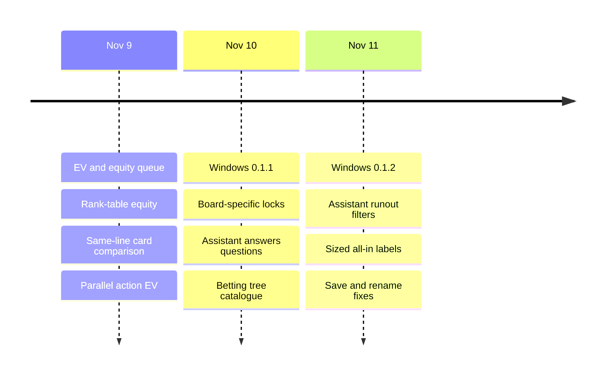

# Project history

Holdem Study is a desktop application for solving and studying heads-up no-limit Hold’em postflop. Matt Azar led the project and used Cursor for implementation. This history covers October 26 through November 11, 2026. Dates are in US Eastern time.

## Timeline

### October 26–29

### October 30–November 3

### November 4–8

### November 9–11

## The first Hold’em solver

On October 26, the first commits set up a C++20 engine with CMake and tests, then gave CFR and CFR+ a shared trainer. The Hold’em code added a seven-card evaluator, an index for the 1,326 distinct two-card combinations, and a way to assign a weight to each combo. The river solver dealt the two hands jointly from their ranges. It removed pairs that shared a card with each other or with the board, then normalized the remaining pair weights. This made a player’s hand distribution depend on which hands the other player could hold. [Shared CFR trainer](https://github.com/matt-azar/poker-solver/commit/18f2f48d0d52bf3de99b8fd95c49e0ee14eca741) · [Hold’em cards and ranges](https://github.com/matt-azar/poker-solver/commit/6d8b8cc3e1d8b23bc201515eb6f6dcc4659bd43c) · [Joint hand distribution](../../HOLDEM.md#joint-distribution)

The first river solver enumerated game histories. Its betting tree put the out-of-position player first. The pot, stack, and allowed sizes defined the game. The reported chip payoff was measured from the root, treating half of the initial pot as each player’s contribution. The solver could therefore report a negative value for folding even before any new chips went in. [First river solver](https://github.com/matt-azar/poker-solver/commit/4cb99ccd4967d2fd08b87228e8a2c572834be382) · [River chip convention](../../RIVER.md#chips)

The winner at showdown depends on the hand pair. The public board and betting line determine which actions are legal. The next implementation took advantage of that distinction by storing one public betting tree and running the hand pairs through it. In the early 30-iteration `22+` versus `22+` river fixture, training fell from 0.248 to 0.068 seconds, with the same reported EV and Nash gap. The enumerator stayed available for checking the batch calculation on small Hold’em trees. [Public-tree river solver](https://github.com/matt-azar/poker-solver/commit/31a5b3c5bc2135d97c477b1072da047bd2278453) · [River measurements](../engineering/BENCHMARKS.md#public-tree-river-traversal)

Turn and flop solves added chance nodes that dealt the remaining public cards. They then reused one public betting structure on each runout. The same sequence of public actions could have separate strategy rows for each legal board and hand. The player could give different streets different size lists. This is how the solver kept exact hand combinations and future cards while limiting the number of actions at a decision. A solve’s equilibrium and accuracy apply to that configured tree. [Flop and turn trees](https://github.com/matt-azar/poker-solver/commit/9ea30368ad5321fe2475b20a352676329bd3123f) · [Street sizes](https://github.com/matt-azar/poker-solver/commit/d2f50aa7e9314b863a22d7c08b03435dae6ebf00) · [Shared betting tree](https://github.com/matt-azar/poker-solver/commit/e064420ace5520801e37631a31d9857b87fa9b21)

The first Explorer was a local browser page. It could build a river tree, run the solver, and show the result. The C++ program served the page and answered its HTTP requests. That division between the engine and the interface carried over to the desktop app. [First Explorer](https://github.com/matt-azar/poker-solver/commit/904c06edb51f3c3bfa9a84ba4baa3ca9361d52ec)

## Frozen passes, memory, and browsing

On October 27, the first frozen pass walked the public tree with vectors of hands. For one player’s pass it held the strategies fixed, accumulated counterfactual regret over the deals, and then set that player’s negative cumulative regrets to zero for CFR+. Doing the floor after accumulation matters because positive and negative contributions from different deals can cancel. The average strategy weighted the current strategy by that player’s own reach and, for CFR+, by the iteration number. The regret update used opponent and chance reach, so a hand with zero own reach could still have a counterfactual value. [Frozen combo pass](https://github.com/matt-azar/poker-solver/commit/d91fb5a164efe5db4fb7ce866dcca6bf822857fa) · [CFR+ update](https://github.com/matt-azar/poker-solver/commit/6a597df5a0a4474c746c59542a329de650dbd7c2) · [Active-player floor](https://github.com/matt-azar/poker-solver/commit/9e0d87d652ad435d2006f3376a8cecb7cd453f70)

The engine added a default allocation limit of 1,024 MiB. It charged a request to the budget before allocating it, which gave an oversized tree a defined failure path. The limit measured engine-owned memory. Benchmarks logged process working set separately. One of the initial capacity tests ran one frozen CFR+ iteration on full-range, check-down turn and flop trees. That test checked memory and the near-zero EV and Nash gap expected from symmetric ranges and a forced check-down. Betting trees had separate convergence tests. [Engine memory budget](https://github.com/matt-azar/poker-solver/commit/56d6f38cb90b28c9b6f1ff2b9dba6137c04ecc1c) · [Allocation accounting](https://github.com/matt-azar/poker-solver/commit/3e9b9efceaebbd231e818a08f92c16b35674b312) · [Capacity test](../engineering/BENCHMARKS.md#full-range-check-down)

Parallel training split the first future public card. A turn solve split its rivers. A flop solve split its turns, with each worker handling the rivers beneath its assigned turn. Different card branches own different information sets, so workers could write to their own regret and strategy rows. Each worker had its own scratch space. The caller combined card values in card order. A one-thread solve used the serial traversal. [Worker scratch](https://github.com/matt-azar/poker-solver/commit/ae4b342057714f71e457fd91e9a7fdb02b25fcb3) · [Parallel training](https://github.com/matt-azar/poker-solver/commit/e2ad8dfa22397f6eab5a10b43eae8a1e7225e689)

Explorer added range painting and flop solves, then switched browsing to requests for one public node at a time. The browser could ask for the strategy and action frequencies at a decision and follow a child after an action or a deal. This kept the interface from having to download a solution’s complete tree and strategy tables before a player could study it. [Flop Explorer](https://github.com/matt-azar/poker-solver/commit/c408f30fa3cae1c173347ef6db492ed57689700f) · [Node-by-node browsing](https://github.com/matt-azar/poker-solver/commit/70ccabcc5fb14b22f47dda0feca66749e21efa8c) · [Action frequencies and next cards](https://github.com/matt-azar/poker-solver/commit/2d6738657aa0ec78aa208aaf37c909459bbe8cb5)

## The postflop study plan

On October 28, the roadmap set a first goal of building a tree, solving it, inspecting EV and equity, saving it, and reopening it to continue. A second stage covered locks, reports, batch jobs, training, and more payoff options. Preflop solving came last. PioSolver 3.11 became the comparison for the study workflow and betting tree conventions. The engine and its file format were developed for this project. On October 29, the roadmap made a graphical interface a release requirement. The license notice adopted on October 28 reserved all rights. [October 28 roadmap](https://github.com/matt-azar/poker-solver/commit/778296731f48a3de76780cab10d9dc47d159e5b5) · [GUI requirement](https://github.com/matt-azar/poker-solver/commit/95242db81c021efe4ec6d2792aee936ddb72db77) · [License](../../../LICENSE)

On October 28, Explorer began preparing a complete status record before making a solution available to browse. If building that record failed, the result stayed unpublished. A solve stopped after a complete iteration could keep the work from that iteration. The first versioned PSOL save stored the configuration, completed iteration count, regrets, and accumulated strategy. That state let the solver continue after reopening. A strategy export had a different purpose and could omit the training state. [Result publication](https://github.com/matt-azar/poker-solver/commit/8ab3503dbafb58cb9dad1acfd97c402caf21ce25) · [Save and continue](https://github.com/matt-azar/poker-solver/commit/3b5df1b37e3a78872ba62f127e0ff27456405049) · [Strategy report](https://github.com/matt-azar/poker-solver/pull/24)

The `street-config 1` text format described a game, including the board, ranges, and betting rules. It was written so that reading it back rebuilt the same tree. Run settings such as the algorithm and iteration limit were chosen separately. Using that format for study fixtures let the command-line solver reproduce a tree that had been inspected or generated elsewhere. [Street config format](https://github.com/matt-azar/poker-solver/commit/4db9186617ba4c28c52e64d9e624e2db0881ab9a) · [CLI support](https://github.com/matt-azar/poker-solver/commit/95d105e364e86cece35aec3b8f4763e2cb83960d) · [Benchmark configs](https://github.com/matt-azar/poker-solver/commit/64121abc492537828bc2b37408c7949693994c3b)

Conditional action EV started as a separate request for flop and turn decisions. It answers what a given hand earns after taking a specified action once, then following the stored average strategies. The calculation weights the compatible opponent hands by their reach at the node. When subtracting blocked hands from the total could erase a small positive weight, the engine summed the compatible hands directly. The value cache followed the published strategy revision, which advanced when training changed the strategy. [Conditional EV](https://github.com/matt-azar/poker-solver/commit/635b1be88720a82b4c69f389c9a1249abe7fd1b0) · [Cache revision](https://github.com/matt-azar/poker-solver/commit/a123c8eacf752a119b28efddaa003d6e37e11bbd) · [Small compatible weights](https://github.com/matt-azar/poker-solver/commit/a803d22d0abfea1cc8928ac64d8b77191ceebaab)

The background value worker could hold a reference to a published solution while it computed EV. The October 28 shutdown fix joined that worker before destroying the session. Reopening or continuing a solve similarly required cancelling active queries and waiting for the worker to release the old state. [Value worker shutdown](https://github.com/matt-azar/poker-solver/commit/27236ac1f8d2ae42aa3130b48351c484a85d8585) · [Continue and Open](https://github.com/matt-azar/poker-solver/commit/b904629ffaffb5c6e0317436389e7e1649e184d7)

The October 29 equity calculation took two weighted ranges and a board and evaluated their expected shares of the pot at showdown if both players checked down. It could run without a solved strategy. Within Study, the selected line supplies the ranges for that calculation. Action EV follows future bets, folds, and calls, so a hand’s check-down equity alone does not tell the player what an action earns. [Exact check-down equity](https://github.com/matt-azar/poker-solver/commit/4c8b2f77049c1995b5f2605507c0beb992b23cfd) · [Equity model](../../EQUITY.md#model)

The first study benchmarks recorded a weighted river case, a turn with river betting, and a one-size flop. They logged elapsed time and NashConv relative to the starting pot. The fixed-iteration tests measured work per iteration. Longer runs checked whether the solver reached a target. Early flop attempts showed the need to record memory, construction, and progress separately. One 2,400-second timeout came from a run whose working set exceeded the free RAM at launch. [Study benchmark runner](https://github.com/matt-azar/poker-solver/commit/51e2b41ada3d142a52c898e9cbe78af766247995) · [Phase logging](https://github.com/matt-azar/poker-solver/commit/381c9a5ad36247c8d71dd94e005e4ddcd4201591) · [Study benchmark results](../../../benchmarks/study/RESULTS.md)

## One postflop engine and a Windows app

Explorer still had separate paths for river and earlier streets. On October 30, the shared engine gained five-card boards, where the tree has zero future cards to deal. Explorer then used `StreetBatchSolver` for all three streets, including river action EV. On November 1, the `river_solver` command began translating its existing inputs into the same street configuration. `RiverGame` continued to supply independent five-card checks. `RiverBatchSolver` stayed available for older river PSOL files and test fixtures. That left one production place to implement new postflop actions, solve controls, and analysis. [Five-card Explorer](https://github.com/matt-azar/poker-solver/pull/8) · [River integration](RIVER_INTEGRATION.md) · [River CLI migration](https://github.com/matt-azar/poker-solver/pull/65)

The same round of changes introduced a terminal payoff for each seat. A chip-only result without rake still gave one player the negative of the other player’s payoff. With rake, some chips leave the pot, so computing one payoff and negating it would credit the wrong amount to the other seat. Explicit payoffs also made it possible to evaluate tournament ICM and add incentives tied to actions or tagged tree edges. [Two-player payoffs](https://github.com/matt-azar/poker-solver/pull/5) · [Rake and five-card integration](https://github.com/matt-azar/poker-solver/pull/34) · [ICM](https://github.com/matt-azar/poker-solver/pull/47) · [Action incentives](https://github.com/matt-azar/poker-solver/pull/69)

The CLI and Explorer gained more control over a running solve. Pause kept the solver available to continue. A time limit stopped after completed work. The evaluation interval controlled how often the engine calculated best responses for accuracy and convergence history. The CLI could export a versioned strategy report from the same run. These controls mattered because computing a best response walks the tree and can take substantial time on a betting flop. [Pause and continue](https://github.com/matt-azar/poker-solver/pull/13) · [Time limit and evaluation cadence](https://github.com/matt-azar/poker-solver/pull/39) · [CLI report](https://github.com/matt-azar/poker-solver/pull/24)

Node locks began as constraints applied during training. A player could fix the strategy of selected combos or the whole node, solve under those constraints, and compare with the previous strategy. The project later added a free-form strategy editor for exploring changes in the session. A manual edit changed the displayed strategy and its analysis. A lock instructed the solver to hold the selected frequencies during the next solve. [First batch lock support](https://github.com/matt-azar/poker-solver/commit/4a0486f9ae46e9e02657d9b48d7856ccb18d397e) · [Constrained re-solve](https://github.com/matt-azar/poker-solver/commit/7d369a7f47cb70505208aef4d3d7c187c8c9bba9) · [Manual strategy editing](https://github.com/matt-azar/poker-solver/pull/66)

On October 31, the React and TypeScript Study client started using the existing Explorer API. Build handled ranges and tree settings. Study showed a strategy matrix, hand details, and betting-path navigation. Library and Compare used the same server for saved solutions and comparisons. Explorer could serve the built React client, with the original browser page available when the build was missing. The new interface and the solver remained separate processes in the desktop package. [React Study client](https://github.com/matt-azar/poker-solver/pull/60)

Tauri packaged the UI and launched the bundled `holdem-explorer` on localhost. The NSIS installer let a Windows user open the app without installing the engine or developer tools separately. The first unsigned installer was published on October 31. Follow-ups fixed webview requests to localhost and made the launcher look beside the installed app for the engine executable. A tag-triggered release workflow later provided a stable installer filename. [Windows installer](https://github.com/matt-azar/poker-solver/pull/61) · [First release](https://github.com/matt-azar/poker-solver/releases/tag/v0.1.0-windows) · [Local connection fix](https://github.com/matt-azar/poker-solver/commit/56309b723e7e13fd131c354a17b1302499359b04) · [Installed engine path](https://github.com/matt-azar/poker-solver/pull/80) · [Release workflow](https://github.com/matt-azar/poker-solver/pull/76)

## Configuring, solving, and saving larger trees

Build first gained a line editor and a memory estimate on November 1. The editor could force or remove an action or add a size at a public path. A preview constructed enough of the tree to show its actions and estimate peak engine allocations without starting training. The estimate let a player revise the tree before committing to a full solve. The same period added flop and turn draw and backdoor categories and nested folders for ranges. [Visual tree editor and memory plan](https://github.com/matt-azar/poker-solver/pull/67) · [Draws and range folders](https://github.com/matt-azar/poker-solver/pull/68)

The size fields went through several revisions. Opening bets and raises got separate lists. The raise cap counted raises after the opening bet. The next version let a blank bet or donk field leave a check-only choice and a blank raise field inherit the street’s bet sizes. A dash removed raises from that field. Geometric sizing moved into the list as `e`, `2e`, or `3e`. The engine expands those tokens using the pot, stack behind, and streets remaining at the decision. The size list also accepts `a` for an all-in, fixed chip amounts, and raise-to multiples. The November 4 change removed the separate geometric switch, so the same size list could describe the tree in Build, the CLI, or a saved config. [Separate bet and raise lists](https://github.com/matt-azar/poker-solver/pull/124) · [Street sizing rules](https://github.com/matt-azar/poker-solver/pull/142) · [Geometric tokens](https://github.com/matt-azar/poker-solver/pull/144)

CFR+ remained the default. The October 31 DCFR implementation discounted cumulative regrets and put more weight on later strategies in the average. It used three parameters for positive regret, negative regret, and strategy averaging, with defaults of 1.5, 0, and 2. On November 2, those parameters became configurable and PCFR+ was added. PCFR+ chooses a strategy using cumulative regret plus the previous pass’s regret update as a prediction. Both options used the frozen public-tree traversal. They shared the game tree and payoff calculations with CFR+. [DCFR](https://github.com/matt-azar/poker-solver/pull/57) · [DCFR parameters](https://github.com/matt-azar/poker-solver/pull/121) · [PCFR+](https://github.com/matt-azar/poker-solver/pull/120)

On November 2, the engine changed the regret and strategy-sum tables from double to single precision. Training and evaluation also began sharing one strategy table. Training uses it for the frozen strategy and evaluation uses it for the normalized average. Those tables fell from 32 to 12 bytes per hand-action entry. The engine kept double precision for counterfactual value sums and NashConv. On November 3, the runout index was packed around legal cards and decisions with one legal action stopped allocating regret and strategy rows. An action with probability one can be reconstructed when reading the strategy. Suit isomorphism and 16-bit tables were separate experiments. [Float tables](https://github.com/matt-azar/poker-solver/pull/126) · [Compact index](https://github.com/matt-azar/poker-solver/pull/134)

The best-response walk first picked up the same board and hand caches as training and used the existing card workers. The next change corrected the value it reported. NashConv sums the gain for each player from switching to a best response while the other player keeps the solved strategy. The old calculation summed the two best-response payoffs. Under zero-sum chips the original payoffs cancel. Rake and incentives can change that sum. The correction made a tree with only forced actions report zero gain from deviation under those payoffs. [Parallel best response](https://github.com/matt-azar/poker-solver/pull/131) · [NashConv correction](https://github.com/matt-azar/poker-solver/pull/133)

PSOL Save had been building large copies of the training tables and serialized bytes in memory. On November 3, the writer began streaming a temporary file with a checksum and replacing the destination after a successful write. Save and Open shared a 2 GiB size ceiling. Save checked the limit before writing, and the readers for the older file versions stayed in place. Warm-starting a solve could also copy the in-memory float tables directly. [Bounded Save and Open](https://github.com/matt-azar/poker-solver/pull/135)

The November 3 Linux measurements used CFR+ and a target of 0.001 NashConv divided by the starting pot. The table records cold process time.

| Study case | Threads | Iterations | NashConv / pot | Wall time |
| --- | ---: | ---: | ---: | ---: |
| Weighted river | — | 340 | 0.000956 | 150.1 s |
| Turn with river betting | 1 | 400 | 0.001920 | 15.61 s |
| Same turn, run to target | 1 | 600 | 0.000989 | 23.88 s |
| One-size flop | 4 | 400 | 0.004694 | 622.2 s |

The engine recorded about 22.8 MB of peak allocations on the turn and 1.74 GB on the flop. The river case reached the same NashConv per pot at the same iteration as the October 30 run. Its recorded wall time rose from 1.11 to 150.1 seconds across runs using different river code paths. The river measurements recorded only whole-process time. The flop run reached its iteration cap before it reached the target. [November 3 benchmark](https://github.com/matt-azar/poker-solver/pull/137) · [Full results and host details](../../../benchmarks/study/RESULTS.md)

The repository moved the CLI programs, HTTP server, and original browser page into their own directories. The next refactor separated tree construction, table storage, traversal, evaluation, and inspection inside the postflop engine. It put one complete CFR+ iteration in `src/solver/postflop/algorithms/cfr_plus.hpp`, with separate files for the other schedules. An HTTP acceptance test exercised a real engine through preview, solve, pause, browse, save, reopen, continue, lock, and compare. [Repository layout](https://github.com/matt-azar/poker-solver/pull/132) · [CFR+ source layout](https://github.com/matt-azar/poker-solver/pull/145) · [HTTP workflow test](https://github.com/matt-azar/poker-solver/pull/136)

## Equity calculator, node locking, and solve progress

The standalone Equity Calculator arrived on November 5. It accepted two to six ranges, a board, and optional dead cards. It could enumerate deals exactly or estimate equity with Monte Carlo sampling. Auto chose between those methods using a deal-count estimate. The calculator ran its own jobs so it could be used without a Study solution. Study equity still meant exact check-down equity using the ranges at the selected node. [Equity Calculator](https://github.com/matt-azar/poker-solver/pull/156) · [Calculator methods](../../EQUITY.md#standalone-equity-calculator)

An installer upgrade could fail while `holdem-explorer.exe` was still running. Closing the UI through the installer could skip the app’s normal shutdown and leave the engine process holding the file open. November 6 fixes stopped the engine during install or uninstall and corrected how the hook called Tauri’s existing NSIS checks. [Installer file-lock fix](https://github.com/matt-azar/poker-solver/pull/158) · [NSIS hook follow-up](https://github.com/matt-azar/poker-solver/pull/161)

On November 7, the range catalogue gained user saves and editable folders by position and action. Study moved node locking out of a side drawer into a dedicated workspace with a 13×13 paint grid. The Bluffs tab listed hands that bet often enough to meet a frequency filter and fell below a chosen equity threshold at the current decision. It then added After call, which looks up equity at the Call child of the relevant bet or raise. That allows the report to use the opponent range that actually calls the bet. [Range catalogue](https://github.com/matt-azar/poker-solver/pull/169) · [Node Locking](https://github.com/matt-azar/poker-solver/pull/171) · [Bluffs](https://github.com/matt-azar/poker-solver/pull/172) · [After-call equity](https://github.com/matt-azar/poker-solver/pull/174)

On November 8, the solve target changed from total NashConv to the average of the two best-response gains, labeled Accuracy. The displayed fraction of the pot therefore uses half the old value for the same solution. The solver reported total NashConv alongside Accuracy. Iteration progress began updating every iteration while full best-response evaluations kept their own cadence. The engine let a worker that finished one public card claim another, since different card branches can take different amounts of work. It also indexed slots by player so each CFR+ regret floor could scan the updating player’s rows directly. [Accuracy target](https://github.com/matt-azar/poker-solver/pull/179) · [Progress updates](https://github.com/matt-azar/poker-solver/pull/180) · [Card task scheduling](https://github.com/matt-azar/poker-solver/pull/177) · [Player slot indexes](https://github.com/matt-azar/poker-solver/pull/176)

## Fixing EV and equity in Study

Study had adopted local decision EV on November 1, with a Global setting for root-centered EV. Local EV adds back what the acting player would lose by folding now. That makes Fold zero and puts the available actions on the same basis. At some decisions the first calculation used half the starting pot and left out chips committed along the betting path. The November 8 fix used the betting state along the path to include those contributions. A regression test checked a 100-chip offset at the start of the turn after a flop bet and call. [Local EV default](https://github.com/matt-azar/poker-solver/pull/83) · [Action order and local EV](https://github.com/matt-azar/poker-solver/pull/182) · [Contribution fix](https://github.com/matt-azar/poker-solver/pull/184)

Explorer’s background value worker initially had one job slot. Study would request EV and equity at the same time. An HTTP 202 meant the job was pending, yet the client released its request queue as soon as that response arrived. Polling one metric could then replace work on the other. A player could revisit a node and get stuck waiting for numbers whose jobs had been repeatedly cancelled. [Earlier load changes](https://github.com/matt-azar/poker-solver/pull/182) · [Analysis scheduling fix](https://github.com/matt-azar/poker-solver/pull/190)

The November 9 change let the worker queue both jobs. Requesting a metric that was already pending or cached reused it. Checking progress became a read of the request’s status. Study held its queue slot until the engine reported success or failure. The cache identified the solution, node, metric, and published strategy revision so a revisit could reuse results for that revision. Automatic requests followed the selected decision. [Automatic node analysis](https://github.com/matt-azar/poker-solver/pull/188) · [Analysis queue and cache](https://github.com/matt-azar/poker-solver/pull/190)

The equity calculation also changed. Study had been passing its ranges through the standalone pair-by-pair evaluator, which redid showdown comparisons the solver already had rankings for. On November 9, it began using the solver’s cached rank tables and blocker counts. Tests compared it with exact enumeration on all three streets. Separately, action EV for a cold flop query began splitting the first eligible chance node across the solver’s workers. These changes addressed computation time after the queue fix addressed cancelled work. [Study equity rank tables](https://github.com/matt-azar/poker-solver/pull/191) · [Parallel action EV](https://github.com/matt-azar/poker-solver/pull/194)

## Studying lines and reusing trees

On November 9, Build mounted a tree preview that used the same job settings as Solve. A preview used one plan-only build for both the action tree and the memory estimate. Study also added a report for comparing the same betting decision across turn or river cards. Its navigation kept the betting path when changing the card, so a player could compare how the same action sequence played on different boards. [Preserve the betting line](https://github.com/matt-azar/poker-solver/pull/139) · [Build preview and card comparison](https://github.com/matt-azar/poker-solver/pull/192)

Study added a way to start a new Build draft from an out-of-position decision at the beginning of the turn or river. It copied the strategy-conditioned ranges, pot, and effective stack from that node. It also reused the relevant sizes and checked the legal root actions. One detail mattered when the in-position player had bet on the previous street. The new tree starts without a previous aggressor, so the source’s donk sizes had to be copied into the out-of-position opening bets. The draft opened in Build for review. [Create a Build draft](https://github.com/matt-azar/poker-solver/pull/193)

The first lock implementation keyed constraints by betting line. It could therefore lock every river on a line when the player intended to lock just the river on screen. On November 10, the default key began retaining the dealt cards. An explicit line lock could still apply to every runout. When both kinds matched, the engine used the board-specific lock first. [Board and line locks](https://github.com/matt-azar/poker-solver/pull/201)

Build first offered file dialogs for saving and opening betting trees. Later on November 10, it moved those saved trees into an in-app catalogue. A betting tree entry stored sizes, caps, and line edits. Applying it reused those settings on the current board and ranges. A PSOL file remained the way to save the full solution and resume training. The same day, Study suspended status polling while Explorer opened or saved a PSOL. File operations could occupy the server’s request loop long enough for a poll to time out and incorrectly show the engine as disconnected. [Save and open trees](https://github.com/matt-azar/poker-solver/pull/203) · [Betting tree catalogue](https://github.com/matt-azar/poker-solver/pull/221) · [Status polling during Open and Save](https://github.com/matt-azar/poker-solver/pull/220)

On November 11, Save As began updating the draft’s file path only after Explorer confirmed the write. The betting-tree catalogue began writing changes to storage before updating its list on screen. Renames kept the same entry ID, and a duplicate name required an explicit replacement. [Save and catalogue fixes](https://github.com/matt-azar/poker-solver/pull/229)

The Windows installer began copying `configs/templates` and `configs/ranges` into the install and setting `POKER_SOLVER_TEMPLATES` and `POKER_SOLVER_RANGES` on the sidecar. The Windows shell began using the native open and save dialogs, with a text prompt if that call fails. [Library assets and dialogs](https://github.com/matt-azar/poker-solver/pull/232)

The packaged shell stopped treating any listener on port 8765 as its engine. It allocates a loopback port, starts one `holdem-explorer` with `--launch-id` and `--study-packaged`, and connects only after `GET /api/ready` reports protocol 1 and that launch id. Browser development still uses an explorer on port 8765. [Packaged engine handshake](https://github.com/matt-azar/poker-solver/pull/233)

Later the same day a Zig engine landed (`engine/`, `app/`, `formats/`, `host/`, `cli/`). The packaged shell then started `solver-engine` first and spoke typed IPC protocol 2. `holdem-explorer` starts when that sidecar is missing or fails ready. The Zig save format is PSOL v4 and rejects older checkpoints. The C++ CLI and HTTP server stayed on `StreetBatchSolver`. Quality cutover numbers were not recorded. The published `v0.1.2-windows` installer predates both the launch-id handshake and this sidecar: it starts `holdem-explorer` on port 8765. [Zig IPC preference](https://github.com/matt-azar/poker-solver/pull/254)

The assistant began on November 1 by turning an explicit setup request into an editable Build draft. It used the same settings as manual setup. On November 2, the code began recording the draft revision before asking the model, so it could detect a manual edit made while the request was pending. The range source and solve rake were separate settings. A 100NL catalogue selection identified the rake structure used to derive those ranges. The player could choose the rake applied to the postflop tree separately. [Build assistant](https://github.com/matt-azar/poker-solver/pull/73) · [Draft revision check](https://github.com/matt-azar/poker-solver/pull/113) · [Range selection](../../STUDY_SETUP_ASSISTANT.md#range-semantics-product-rules)

On November 9, the project began generating the assistant’s reference material from source files checked against the UI and gave it access to live strategy data. On November 10, product and poker questions used a separate route that could read the current decision. On November 11, the assistant gained a Study action that filters the Compare runouts report by card and ranks the results by an action’s frequency. A selected result opens through the same path as a manual click. [Assistant documentation](https://github.com/matt-azar/poker-solver/pull/196) · [Current-decision data](https://github.com/matt-azar/poker-solver/pull/197) · [Question answering](https://github.com/matt-azar/poker-solver/pull/216) · [Runout filtering](https://github.com/matt-azar/poker-solver/pull/224)

The unsigned Windows releases `v0.1.1-windows` and `v0.1.2-windows` were published on November 10 and 11. Runout filtering, sized all-in labels, the save fixes, library staging, native dialogs, and the packaged-engine handshake merged after 0.1.2 was published. [Windows 0.1.1](https://github.com/matt-azar/poker-solver/releases/tag/v0.1.1-windows) · [Windows 0.1.2](https://github.com/matt-azar/poker-solver/releases/tag/v0.1.2-windows) · [Sized all-in labels](https://github.com/matt-azar/poker-solver/pull/225)

By November 12, the roadmap still listed compact saves, a persistent batch queue, training drills, preflop solving, and signed installers as future work. Matched benchmarks with PioSolver were still outstanding. A Zig CFR+ sidecar was in the tree. Its quality-cutover checklist was not recorded as passed. [Roadmap](../planning/ROADMAP.md)

## Current documentation

[Architecture](../../ARCHITECTURE.md) · [Postflop engine](../../STREETS.md) · [Desktop UI](../../DESKTOP_UI.md) · [Zig release gates](../engineering/ZIG_RELEASE_GATES.md) · [Feature comparison](../planning/FEATURE_PARITY.md)
